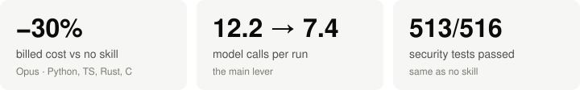
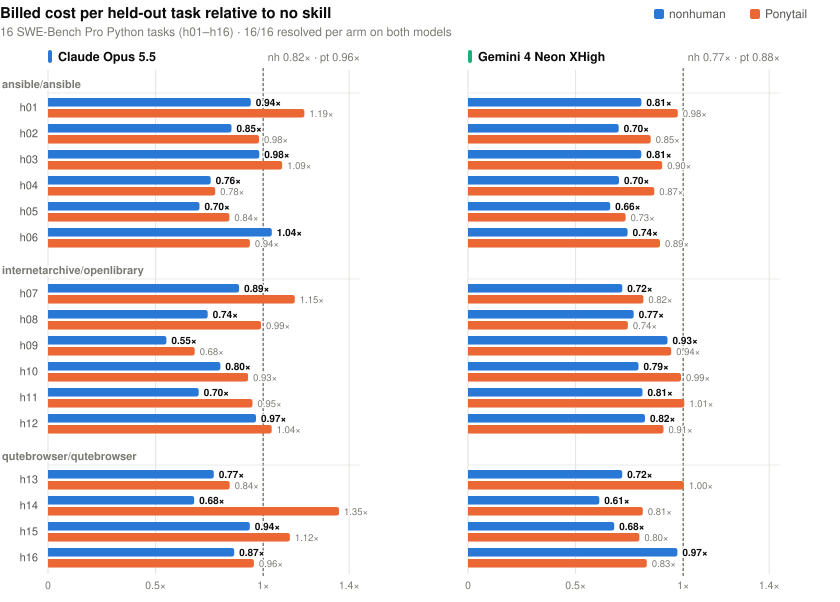

# nonhuman

Agent-first coding mode. One 700-token skill for any coding agent.

<picture>
  <source media="(prefers-color-scheme: dark)" srcset="assets/hero-dark.svg">
  
</picture>

## Philosophy

Agent-written code is increasingly read only by agents. Comments, padding, narration, and extra round-trips serve a human reader who is not there, and every following agent pays for them. Optimise for the next agent: **fewest billed tokens per correct, secure result.** Readability is optional. Validation, auth, escaping, bounds checks, and error handling are not.

## Math

An agent run is $N$ model calls. Call 1 pays for the fixed prefix $P$ ($u$ cache-write misses); each subsequent call re-reads $P$ plus every accumulated delta $\Delta_i$ (tool results, edits, prior turns) and emits visible output $o_i$ and thinking $h_i$. In units of one fresh input token (cache write $w_c$, cache read $r_c$, output $w_o$):

$$
C = \underbrace{P\bigl(w_c u + r_c(N - u)\bigr)}_{\text{prefix re-reads}} + \underbrace{\sum_{i=1}^{N} \Delta_i\bigl(w_c + r_c(N - i)\bigr)}_{\text{context growth}} + \underbrace{w_o \sum_{i=1}^{N} (o_i + h_i)}_{\text{output + thinking}}
$$

$$
\mathbb{E}[C_{\text{task}}] = \frac{C}{p_{\text{success}}}
$$

Both **Claude Opus 5.5** (`1 / 1.25 cw / 0.05 cr / 5 out`) and **Gemini 4 Neon** (`$3 / $0.15 / $15` per 1M, implicit caching: `1 / 0.05 cr / 5 out`, $w_c = 1$) share $r_c = 0.05$ and $w_o = 5$. This is exact accounting (matches every run bill to `0.00%` across all 96 SWE-Bench Pro runs):

| quantity (48 held-out runs per model) | Claude Opus 5.5 | Gemini 4 Neon XHigh |
|---|---|---|
| one extra call · $\operatorname{corr}(N, C)$ | `≈ 13.4k` units (`6.7%` of mean) · `0.63` | `≈ 30.7k` units (`4.0%` of mean) · `0.62` |
| no-skill bill split (prefix · growth · visible · thinking) | `32%` · `30%` · `25%` · `13%` | `5%` · `38%` · `11%` · `47%` |
| ceiling of "write terser code" alone | visible output is `25%` of bill | visible output is `11%` of bill |

**$N$ is the lever.** Cutting round-trips shrinks context growth on both models and eliminates whole thinking turns on high-reasoning models.

<picture>
  <source media="(prefers-color-scheme: dark)" srcset="assets/cost-anatomy-dark.svg">
  
</picture>

## Rules

1. **Fewer calls.** Batch independent tool calls; read targeted ranges once; one edit per file; verify once; check every requirement against the diff before replying.
2. **Cut ephemeral output, never the contract.** No narration, recap, or re-printed code; minimal diffs; reuse before writing. Keep exact spec names and every required case — smallest diff never means smallest behaviour.
3. **Keep what the next agent needs.** Typed signatures (codebase convention); a one-line comment only for a non-obvious invariant or security reason; at most one compact test.
4. **Small tool output.** `-q`, `| tail`, grep for failures; never cut off the failing line.
5. **Never cut** validation, auth, escaping, path-traversal guards, bounds/overflow checks, or data-loss error handling.

Full text: [`skills/nonhuman/SKILL.md`](skills/nonhuman/SKILL.md) · Failure modes & guards: [`FAILURE_MODES.md`](FAILURE_MODES.md).

## Benchmarks

### 1. Real repositories — SWE-Bench Pro (primary)

16 held-out Python tasks from the [SWE-Bench Pro](https://arxiv.org/abs/2509.16941) public `hard` split (`h01`–`h16`: 6 `ansible`, 6 `openlibrary`, 4 `qutebrowser`), `n = 1` per arm, no-network Docker containers with hidden tests removed, graded by the official evaluator ([documented fixes](bench/real/EVALUATOR_PATCH.md)) with `16/16` passing gold-patch controls on both models.

<picture>
  <source media="(prefers-color-scheme: dark)" srcset="assets/cost-per-task-dark.svg">
  
</picture>

#### Claude Opus 5.5 *(Claude Code · pre-registered)*

| metric (`h01`–`h16`, `n = 1` / arm) | no skill | Ponytail | **nonhuman v1.2** |
|---|---:|---:|---:|
| billed cost at list prices (95% CI) | `1.00×` | `0.96×` (`0.89–1.05`) | **`0.82×` (`0.76–0.88`)** |
| model calls / run | `13.7` | `14.8` | **`11.2`** (`−18%`) |
| resolved (`FAIL_TO_PASS` + `PASS_TO_PASS`) | `16/16` | `16/16` | **`16/16`** (`W0 / L0`) |
| tasks cheaper than no skill | — | `10/16` | **`15/16`** |

- **Pre-registration:** criteria (`cost ≤ 0.95×`, `L − W ≤ 2`), task list, and skill hash were [locked before the first v1.2 run](results/real/PREREG.md); all passed.
- **Data & verification:** [`results/real/`](results/real/README.md) · `python3 scripts/verify.py` (standard library only).

#### Gemini 4 Neon XHigh *(Antigravity CLI · cross-model & cross-harness check)*

| metric (`h01`–`h16`, `n = 1` / arm) | no skill | Ponytail | **nonhuman v1.2** |
|---|---:|---:|---:|
| billed cost at `$3 / $0.15 / $15` list prices (95% CI) | `1.00×` (`$42.20`) | `0.88×` (`0.83–0.92`, `$36.96`) | **`0.77×` (`0.72–0.81`, `$32.32`)** |
| model calls / run | `28.2` | `24.8` | **`20.6`** (`−27%`) |
| wall time / run | `16.2m` | `14.6m` | **`13.8m`** (`−15%`) |
| resolved (`FAIL_TO_PASS` + `PASS_TO_PASS`) | `16/16` | `16/16` | **`16/16`** (`W0 / L0`) |
| tasks cheaper than no skill | — | `14/16` | **`16/16`** |

- **Vs Ponytail:** **`0.87×` (`0.83–0.92`)**, cheaper on **14/16** tasks — even though Antigravity loaded both `rules/AGENTS.md` and `rules/GEMINI.md` (`+1,467` tok prefix vs Ponytail's `+715` tok).
- **By repository:** `ansible` `0.73×`, `openlibrary` `0.82×`, `qutebrowser` `0.73×`. All post-base git refs were purged before every run (`refs == 0`).
- **Data & verification:** [`results/real_gemini_neon/RESULT.md`](results/real_gemini_neon/RESULT.md) · `python3 scripts/verify.py --runs results/real_gemini_neon/billed_runs.csv --grades results/real_gemini_neon/grades_neon.jsonl`.

---

### 2. Controlled fixtures (secondary)

Four services (`py`, `ts`, `rs`, `c`, 23 tasks total) with hidden functional and **security** tests (SQLi, path traversal, authz, overflow, XSS, ASan leaks); specs never mention security. `n = 3` runs per language per arm.

| model (harness) | arm | billed cost | calls / run | security tests | functional tests |
|---|---|---:|---:|---:|---:|
| **Claude Opus 5.5** *(Claude Code)* | no skill | `1.00×` | — | `513/516` | `499/510` |
| | Ponytail | `1.00×` | — | `513/516` | `498/510` |
| | nonhuman v1.0 | `0.71×` | — | `513/516` | `498/510` |
| | **nonhuman v1.2** | `0.86×` (`≈0.78×` cache-norm.) | — | **`513/516`** | **`498/510`** |
| **Gemini 4 Neon XHigh** *(Antigravity CLI)* | no skill | `1.00×` (`$14.62`) | `8.9` | `513/516` | `501/510` |
| | **nonhuman v1.2** | **`0.77×` (`0.73–0.81`, `$11.20`)** | **`6.1`** | **`513/516`** | **`501/510`** |

> [!NOTE]
> **Fixture disclaimers:** Controlled fixtures are synthetic multi-task single-prompt tests meant to stress-test security retention, not a substitute for real repositories. Opus 5.5 fixture ratios use the pre-2026-11-25 10% cache-read weight and all Opus v1.2 runs started with a cold prompt cache (`≈+20k` units/run, a harness artifact). Gemini 4 Neon XHigh fixtures use official `$3 / $0.15 / $15` list prices (`12/12` runs cheaper: `py 0.84×`, `ts 0.80×`, `rs 0.74×`, `c 0.70×`) and ran `no skill` vs `nonhuman v1.2` only (Ponytail was evaluated on the primary 16-task SWE-Bench Pro benchmark instead). Raw data: [`results/fixture_v12/`](results/fixture_v12/) · [`results/fixture_gemini_neon/`](results/fixture_gemini_neon/README.md).

## Install

| Platform | Command |
|---|---|
| **Claude Code** *(verified live)* | `claude plugin marketplace add nagisanzenin/nonhuman` → `claude plugin install nonhuman@nonhuman` |
| **Antigravity** *(verified live)* | `agy plugin install https://github.com/nagisanzenin/nonhuman` |
| **Codex** | `codex plugin marketplace add nagisanzenin/nonhuman` → `codex plugin add nonhuman@nonhuman` |
| **Gemini CLI** | `gemini extensions install https://github.com/nagisanzenin/nonhuman` |
| **Cursor · Windsurf · Cline · Copilot · Kiro** | copy the platform file from [`rules/`](rules/) |
| **AGENTS.md agents** *(OpenCode, Amp, Goose, Jules)* | append [`rules/AGENTS.md`](rules/AGENTS.md) |

## Limits

- Real-repo tasks are Python only (`ansible`, `openlibrary`, `qutebrowser`): Go and JS repos hung or OOM'd under x86 emulation on the test host.
- `n = 1` per arm per SWE-Bench Pro task: `16/16` parity on both frontier models rules out large regressions, not small single-digit resolve differences.
- Thinking budgets were left at each harness's default; results above are for frontier reasoning models (Opus 5.5 and Gemini 4 Neon XHigh) and may not transfer identically to smaller models.

MIT.
