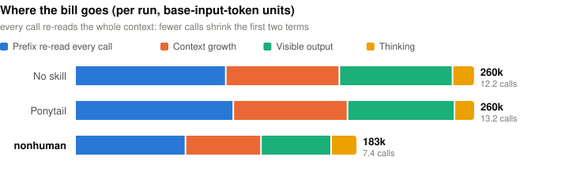
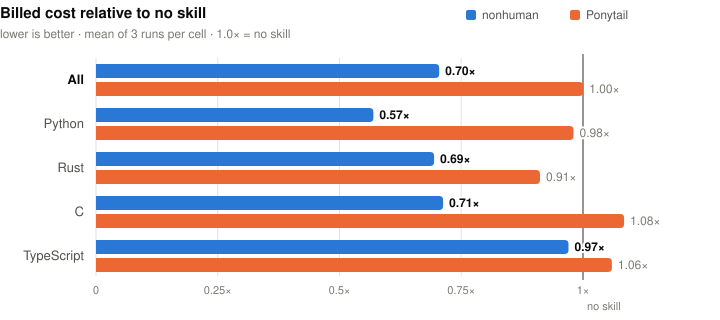

# nonhuman

Agent-first coding mode. One 500-token skill for any coding agent.

<picture>
  <source media="(prefers-color-scheme: dark)" srcset="assets/hero-dark.svg">
  
</picture>

## Philosophy

Code written by agents is increasingly read only by agents. Comments, padding, narration and extra round-trips serve a human reader who is not there, and every following agent pays for them. Optimise for the next agent: **fewest billed tokens per correct, secure result.** Readability is optional. Validation, authorisation, escaping, bounds checks and error handling are not.

## Math

An agent run is N model calls. Each call re-reads the fixed prefix P and everything appended so far (Δᵢ = tool results + own output), then emits visible output oᵢ and thinking hᵢ. With prices relative to base input (cache write 1.25, cache read 0.1, output 5):

```
C = P·(1.25u + 0.1N)  +  Σᵢ Δᵢ·(1.25 + 0.1(N − i))  +  5·Σᵢ (oᵢ + hᵢ)          E[C_task] = C / p_success
    prefix re-reads       context growth                 output + thinking
```

The decomposition is accounting, not a fit: on 84 runs (830 billed calls) it matches every bill to within 0.02%. Fitted across the 36 Opus runs:

| quantity | value (Opus) |
|---|---|
| one extra call | ≈ 13.8k units, 5.9% of a run · corr(N, C) = 0.88 |
| one output token | ≈ 6.6 units: billed ×5, then re-read every later call |
| cost split | prefix 39% · context growth 28% · output 27% · thinking 6% |
| ceiling of "write terser code" | < 10% of the bill |

**N is the lever.** Terse code helps; fewer calls helps more.

<picture>
  <source media="(prefers-color-scheme: dark)" srcset="assets/cost-anatomy-dark.svg">
  
</picture>

## Rules (the whole skill)

1. **Fewer calls.** Batch independent tool calls; read targeted ranges once; one edit per file; verify once.
2. **Less output.** Minimal diffs; no comments, docstrings, narration or recap; reuse before writing; at most one compact test per task.
3. **Small tool output.** `-q`, `| tail`, grep for failures.
4. **Never cut** validation, auth, escaping, path-traversal guards, bounds/overflow checks, data-loss error handling.

Full text: [`skills/nonhuman/SKILL.md`](skills/nonhuman/SKILL.md).

## Benchmark

<picture>
  <source media="(prefers-color-scheme: dark)" srcset="assets/cost-by-language-dark.svg">
  
</picture>

| hidden tests passed (Opus, 36 runs) | no skill | Ponytail | nonhuman |
|---|---|---|---|
| functional | 499/510 | 498/510 | 498/510 |
| security | 513/516 | 513/516 | 513/516 |

- **Fixtures:** Python service, TypeScript service, Rust crate, C library; 23 feature tasks. Hidden functional and security tests (SQL injection, path traversal, authz, overflow, XSS, leaks under ASan). Specs never mention security. Reference solutions pass 100%; mutants are caught.
- **Arms:** no skill · [Ponytail](https://github.com/DietrichGebert/ponytail) (strongest public alternative) · nonhuman. 3 runs per cell, Claude Opus.
- **Cost:** per-call billed usage from transcripts (input, cache write, cache read, output, thinking). No estimates.
- **The one functional gap:** a spec-ambiguous TypeScript check (empty code → 400 or 404) that one no-skill run passed and every other run failed.

Reproduce: `bench/prep.py` → run your agent on `PROMPT.md` → `bench/score.py` → `bench/billed.py` → `scripts/summarize.py`, `scripts/charts.py`. Raw data in [`results/`](results/).

## Install

| Platform | |
|---|---|
| Claude Code | `claude plugin marketplace add nagisanzenin/nonhuman` → `claude plugin install nonhuman@nonhuman` |
| Codex | `codex plugin marketplace add nagisanzenin/nonhuman` → `codex plugin add nonhuman@nonhuman` |
| Gemini CLI | `gemini extensions install https://github.com/nagisanzenin/nonhuman` |
| Antigravity | `agy plugin install https://github.com/nagisanzenin/nonhuman` |
| Cursor · Windsurf · Cline · Copilot · Kiro | copy the file from [`rules/`](rules/) into the platform's rules folder |
| AGENTS.md agents (OpenCode, Amp, Goose, Jules) | append [`rules/AGENTS.md`](rules/AGENTS.md) |

Install routes follow each platform's documented format; not all are verified live yet.

## Limits

One harness (Claude Code subagents), one model per study, 3 runs per cell, purpose-built fixtures. Prompts held several tasks, so batching across tasks helped; single-task sessions save less (TypeScript, already at ~7 calls, saved 3%). Thinking budget at harness default.

MIT.
